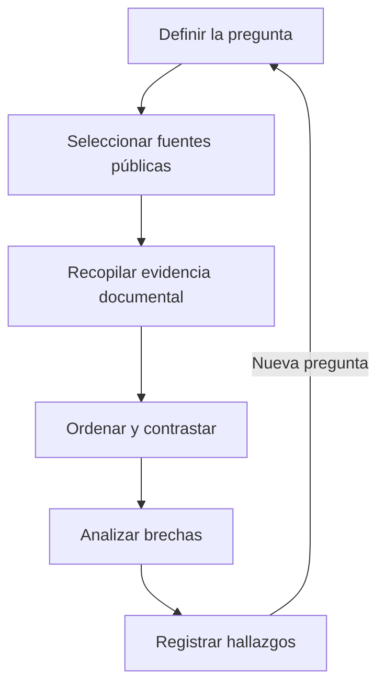
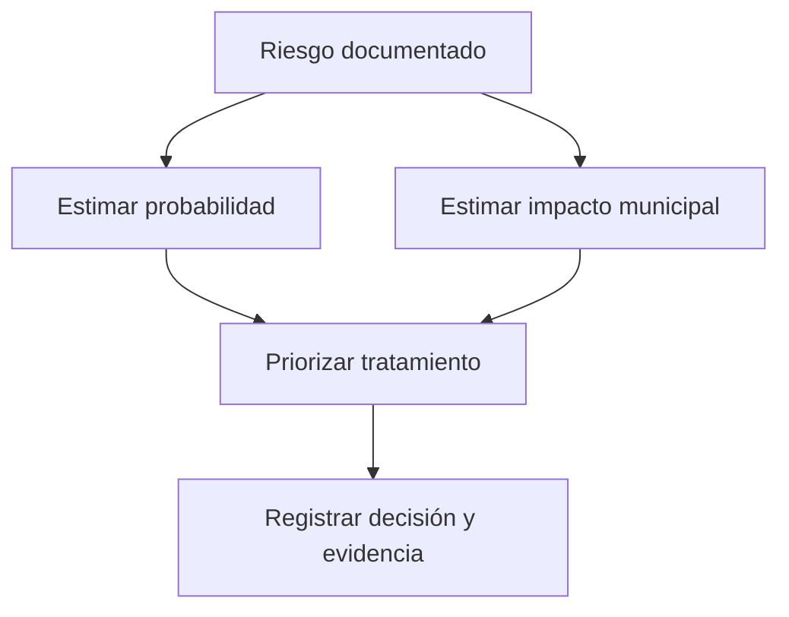
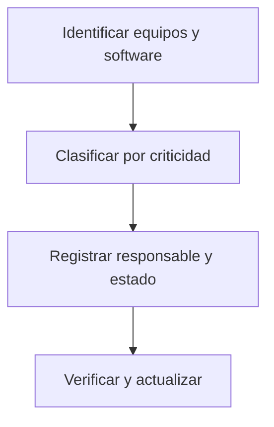

# Figuras del diagnóstico municipal

[Portada](../README.md) · [Índice de documentación](../README.md#documentación) · [Cómo citar](versiones-y-citacion.md#cómo-citar)

Los diagramas son adaptaciones para GitHub de las figuras y secciones de diagnóstico de la tesis. Los gráficos estadísticos del Word se sintetizan aquí como criterios de revisión local. Para cifras históricas, consulta los informes citados en el proyecto de título.

## Contexto municipal

| Tema de las figuras originales | Qué revisar en el municipio |
| --- | --- |
| Recursos humanos por grupo comunal | Dotación de TI, tiempo disponible para seguridad y cobertura de reemplazo. |
| Plan de respuesta a incidentes | Existencia del plan, fecha de revisión, roles y evidencias de ejercicios. |
| Dedicación a ciberseguridad | Si la función está asignada, quién la desempeña y cuánto tiempo tiene disponible. |

## Ciclo de revisión de fuentes abiertas

## Referencias del marco y niveles

La figura NIST del proyecto de título usa la estructura de cinco funciones de CSF 1.1: Identificar, Proteger, Detectar, Responder y Recuperar. CSF 2.0 incorpora Gobernar como sexta función. La tesis usa el Tier 1 como supuesto inicial del diagnóstico documental y el Tier 2 como objetivo del MCA.

| Nivel de NIST | Lectura en el diagnóstico |
| --- | --- |
| 1 · Parcial | Punto de partida de referencia del MCA. |
| 2 · Informado por el Riesgo | Estado objetivo del MCA. |
| 3 · Repetible | Referencia para una evolución posterior. |
| 4 · Adaptativo | Referencia para una evolución posterior. |

CIS organiza las salvaguardas en tres grupos de implementación. El MCA prioriza la higiene inicial de **IG1**. **IG2** y **IG3** incorporan salvaguardas adicionales según el riesgo y la capacidad. Consulta la [correspondencia CIS](controles-cis.md).

## Priorización de riesgos

Para valorar el impacto, registra el servicio afectado, las consecuencias para la continuidad y los datos comprometidos. La prioridad se revisa con la evidencia local.

## Inventario y recuperación

**Regla 3-2-1 de respaldo.** Mantén tres copias en total, en dos tipos de medios o soportes, con una copia fuera del sitio principal. El MCA también considera el aislamiento de una copia y la verificación de la restauración.

Fuentes: [NIST CSF 1.1](https://doi.org/10.6028/NIST.CSWP.04162018) · [NIST CSF 2.0](https://doi.org/10.6028/NIST.CSWP.29) · [CIS Controls v8.1](https://www.cisecurity.org/controls/cis-controls-list).
