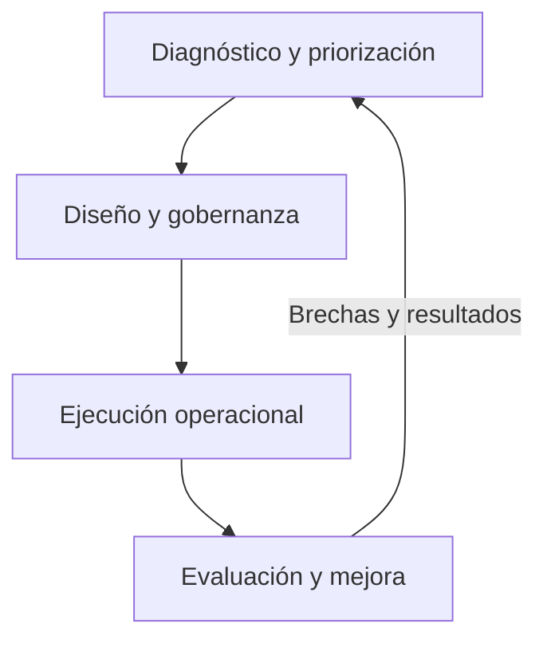

# Modelo e implementación

El Modelo de Ciberseguridad Adaptativo (MCA) utiliza NIST CSF como marco de referencia para organizar la gestión del riesgo y CIS Controls IG1 como referencia para priorizar salvaguardas. La propuesta ajusta las tareas a la capacidad operativa del municipio y concentra el esfuerzo inicial en servicios y activos críticos.

## Ciclo de implementación

| Fase | Trabajo principal | Evidencia esperada |
| --- | --- | --- |
| Diagnóstico y priorización | Inventariar activos críticos e identificar los riesgos prioritarios. | Inventario inicial y registro de riesgos. |
| Diseño y gobernanza | Aprobar una política simplificada, asignar responsabilidades y definir el procedimiento de recuperación. | Política, matriz RACI y procedimiento de respaldo y restauración. |
| Ejecución operacional | Aplicar controles priorizados de inventario, actualización y capacitación. Incorporar monitoreo básico según la capacidad disponible. | Registros de ejecución y seguimiento. |
| Evaluación y mejora | Revisar indicadores y probar la restauración de respaldos. Usar los resultados para ajustar la siguiente iteración. | Reporte de indicadores y evidencia de la prueba de restauración. |

## Hoja de ruta

La tesis describe cuatro niveles de adopción del MCA: **Identificar**, **Formalizar**, **Ejecución técnica** y **Recuperar**. Estos niveles ordenan la adopción municipal. El Tier 2 de NIST es el estado de referencia al que apunta el modelo.

## Roles propuestos

| Rol del modelo | Responsabilidad principal |
| --- | --- |
| Oficial de Seguridad Lógico (OSL) | Coordinar la ejecución técnica de los controles, la gestión de incidentes y los respaldos. |
| Oficial de Riesgo y Cumplimiento (ORC) | Supervisar el registro de riesgos y el seguimiento de los compromisos. |
| Patrocinador Ejecutivo (PE) | Aprobar la política y patrocinar la continuidad y recuperación. |

La asignación a cargos existentes debe ajustarse al organigrama y a las atribuciones del municipio. La matriz RACI identifica quién ejecuta, quién aprueba, quién debe ser consultado y quién debe ser informado por tarea.

## Indicadores de seguimiento

| Indicador | Medición |
| --- | --- |
| Cobertura de inventario | Activos críticos inventariados sobre el total de activos críticos identificados. |
| Cobertura de capacitación | Personal capacitado sobre el total de personal incluido en el plan. |
| Tiempo de aplicación de parches | Días entre la disponibilidad de un parche crítico y su instalación. |
| Eficacia de respaldos | Restauraciones exitosas sobre el total de pruebas realizadas. |
| Asignación de roles | Verificación de las designaciones y responsabilidades documentadas. |

Base documental: capítulo 4 del proyecto de título. El diagrama es una adaptación para GitHub del flujo descrito en la sección 4.7.
